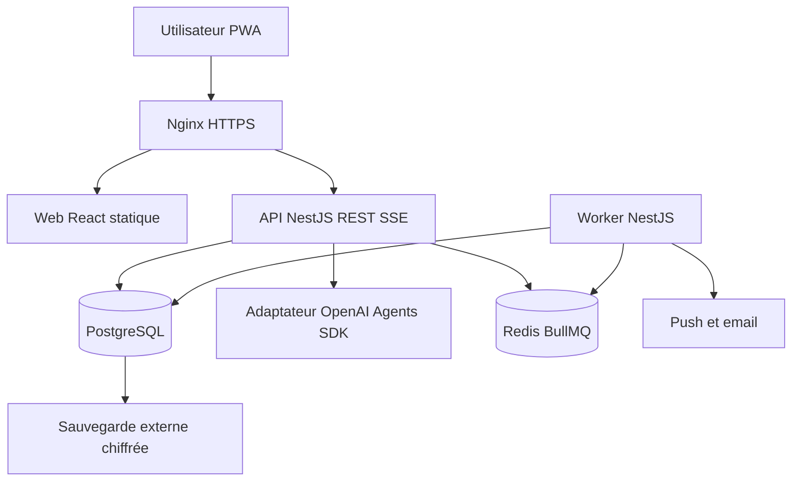

# Architecture — Congelator

Statut : cadrage validé le 27 novembre 2026 ; détails d’implémentation proposés. Nom retenu : Congelator. Voir [PRODUCT](PRODUCT.md) pour le comportement et [ADR](adr/README.md) pour les décisions.

## Registre

| ID | Sujet | Décision |
|---|---|---|
| TA-001 | Stack | React + Vite + TanStack ; NestJS ; TypeScript strict ; REST/OpenAPI et SSE. |
| TA-002 | Monorepo | pnpm + Nx ; projets et tags ; frontières lint ; client généré. |
| TA-003 | Architecture | Monolithe modulaire, DDD, hexagonale, CQRS logique ; Domain Events, Outbox si nécessaire ; pas d’Event Sourcing. |
| TA-004 | Persistance | PostgreSQL + MikroORM ; mapping séparé pour agrégats complexes ; transactions et migrations. |
| TA-005 | Identité | Better Auth, sessions cookies, RBAC par foyer, RLS PostgreSQL. |
| TA-006 | Stock | StockLot racine ; StockPosition porte les quantités ; StockMovement historique immuable. |
| TA-007 | Agent IA | OpenAI Agents SDK, agent unique évolutif ; tools métier ; règles déterministes ; SSE. |
| TA-008 | Mémoire | PostgreSQL source de vérité ; Session adapter ; contexte borné ; préférences structurées ; PendingAction. |
| TA-009 | Dictée | Web Speech API en V0.3 ; OpenAI puis Whisper après V1.0 ; sélection progressive. |
| TA-010 | Jobs | BullMQ + Redis + worker NestJS indépendant ; Outbox ; notifications internes, push et e-mail. |
| TA-011 | Frontend | Feature-based ; Tailwind, shadcn/ui, Lucide, Storybook, Orval, MSW, i18next, Workbox. |
| TA-012 | Tests | Quality Engineering + TDD pragmatique ; Vitest, Testcontainers, Playwright, fast-check, évaluations IA. |
| TA-013 | Infrastructure | Production personnelle initiale, Docker Compose, Nginx existant, Actions/GHCR ; Ansible/OpenTofu progressifs. |
| TA-014 | Sécurité et observabilité | Security & Observability by Design progressive ; Pino, OpenTelemetry, Grafana progressif ; quotas IA. |

## Topologie cible



API et worker partagent les mêmes bibliothèques métier. Redis est une infrastructure de jobs, pas la source de vérité des stocks. Aucune transaction SQL ne traverse un appel réseau IA. Pas de microservices métier, pas de Kubernetes obligatoire.

## Frontières et organisation Nx

Structure cible (créer les projets à mesure de leur utilité) :

```text
apps/{api,web,worker}/
libs/backend/<context>/{domain,application,infrastructure,feature}/
libs/frontend/<feature>/{feature,ui,data-access,util}/
libs/frontend/design-system/
libs/shared/{api-client,assistant-contracts}/
libs/testing/
tests/{e2e,security,performance,ai-evals}/
infrastructure/
docs/adr/
```

Contexts : Identity, Households, Freezers, Catalog, Inventory, Preservation, Assistant, Notifications, Meals, Preferences. Transcription est une capacité technique. Utiliser des APIs applicatives publiques ou événements explicites entre contextes, pas de dépendance circulaire ni d’accès aux repositories privés d’un autre contexte.

- Domain : classes TypeScript pures, invariants, événements, VO ; aucun NestJS, ORM ou SDK IA.
- Application : use cases, ports, politiques, handlers ; dépend du domaine. Les décorateurs CQRS peuvent être confinés à des wrappers d’intégration si nécessaires.
- Infrastructure : implémente les ports, mapping, DB, IA, transports.
- Feature : composition NestJS, contrôleurs et DTO. Les rôles techniques et la vérification d’appartenance sont injectés côté serveur.
- Tags Nx `platform`, `scope`, `type` ; ESLint restreint aussi les dépendances externes. Lint et vérification de cycles bloquants.
- Les queries utilisent des projections SQL typées ; les commands passent par le domaine. Le code de lecture ne modifie pas le stock.

## Frontend

Routes `/households/$householdId/...` ; query keys avec identité/contexte ; purger les caches privés à la déconnexion et au changement de compte, invalider après mutation. TanStack Form pour formulaires ; état local React, store global uniquement si besoin justifié. Design tokens, composants shadcn, stories et états vide/erreur/chargement. Orval génère types/hooks/mocks à partir du contrat NestJS ; CI vérifie leur fraîcheur. SSE utilise un contrat versionné et un client dédié. Aucun import de DTO internes, entités ou services backend. i18next et Intl ; français initial. PWA : cache statique seulement par défaut, pas de données privées ou mutations offline. UI IA via registre fermé, jamais HTML/JS arbitraire.

## Stock transactions and job delivery

V0.2 introduces transactional stock changes, immutable movements, idempotency, and domain events. V0.4 introduces the Transactional Outbox with BullMQ, Redis, and the independent worker. A concrete requirement for reliable asynchronous delivery can bring the Outbox forward. Once the Outbox is in use, persist each relevant event in the same transaction as the corresponding business change and its audit record when applicable.

The relay uses locking and supports recovery. Delivery is at least once, and consumers are idempotent with persistent deduplication keys, bounded retries, and inspectable failures. Keep unnecessary personal data out of Redis. Calculate preservation dates deterministically and revalidate notifications before sending, taking time zones and quiet hours into account.

## Foundation POCs and open decisions

Follow the [V0.1 backlog](ROADMAP.md#v01-backlog) for the division between the database and authenticated RLS POCs. Verify compatibility of stable Node, pnpm, Nx, NestJS, React, Vite, and Vitest releases in `BOOT-001`. Verify MikroORM, SWC, Better Auth, and OpenAPI generation in the relevant follow-up tickets, and verify PWA installability in V0.1. Pin versions and images after verification.

See the [open data model questions](DATA_MODEL.md#open-data-model-questions) for schema and decimal decisions. Before V0.4, validate how the worker obtains its restricted tenant context, including pooled connections, and select an email provider. The [roadmap](ROADMAP.md#outstanding-decisions-and-target-milestones) indexes open decisions by milestone. A substantial architecture change requires an ADR and human approval.
